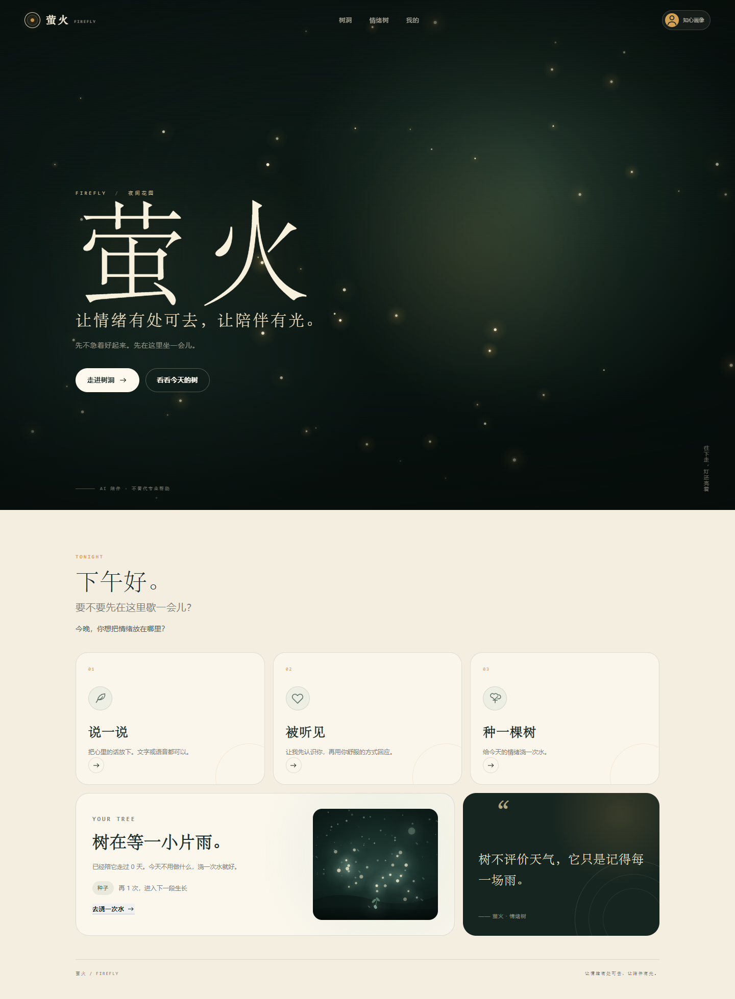
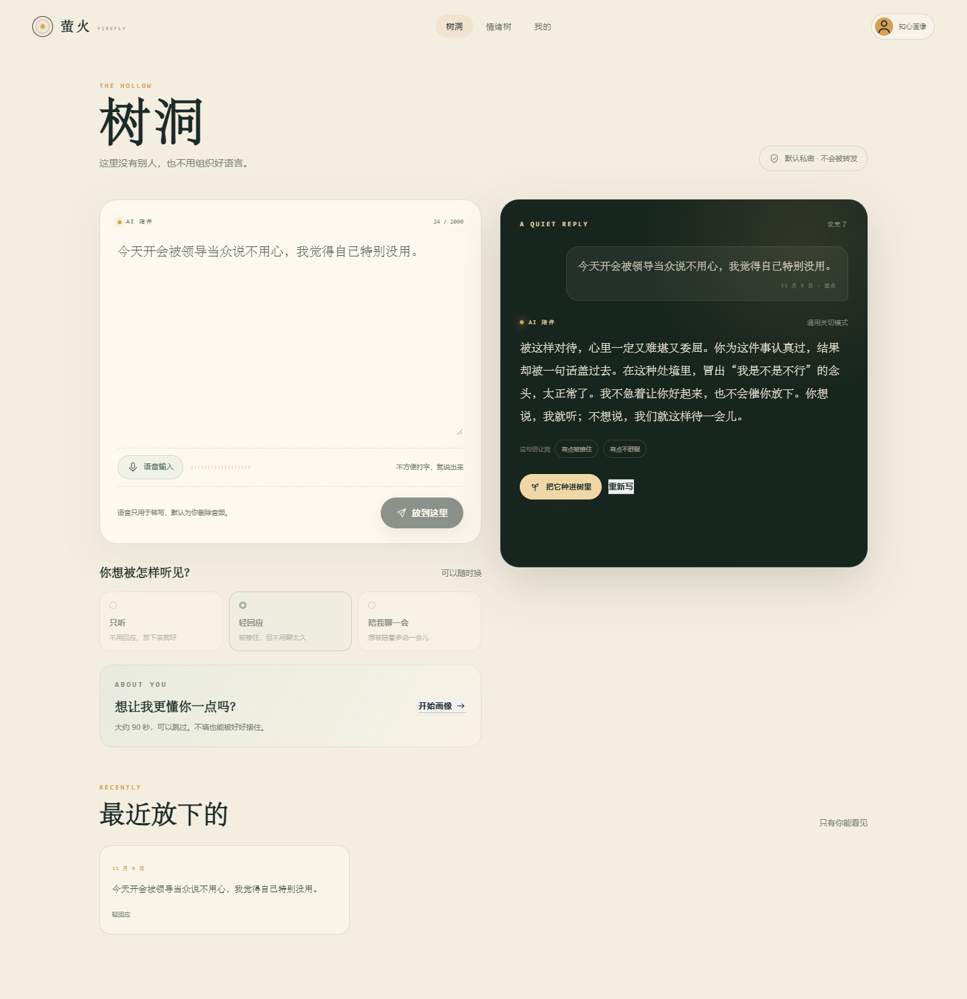
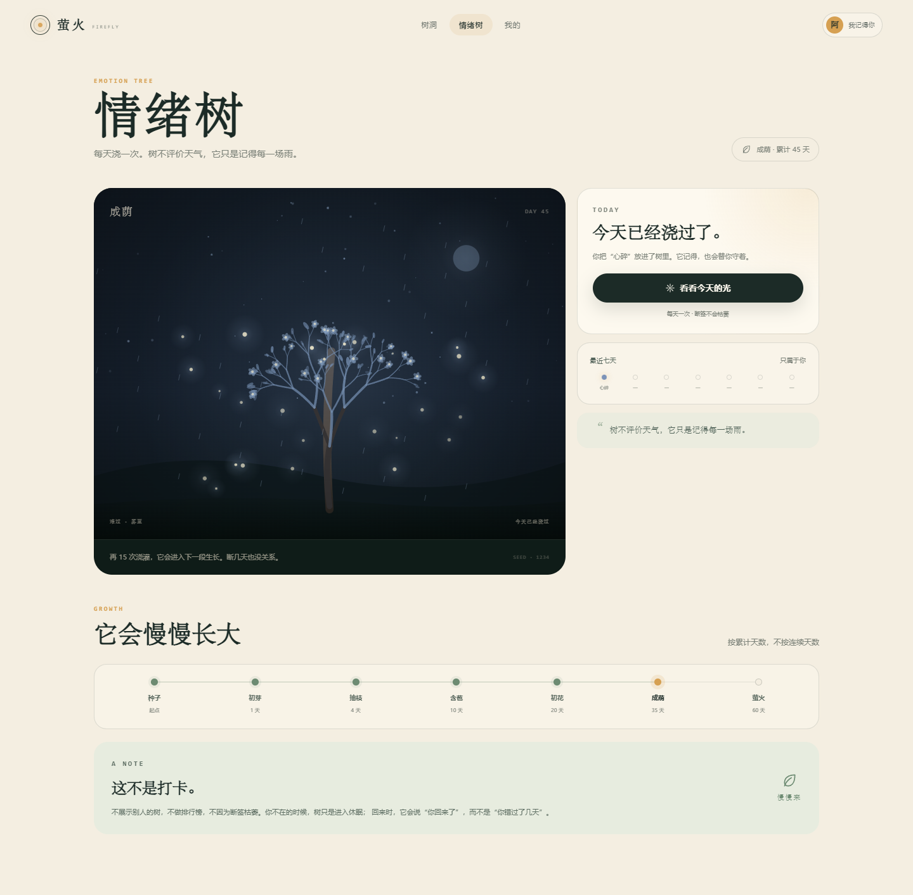
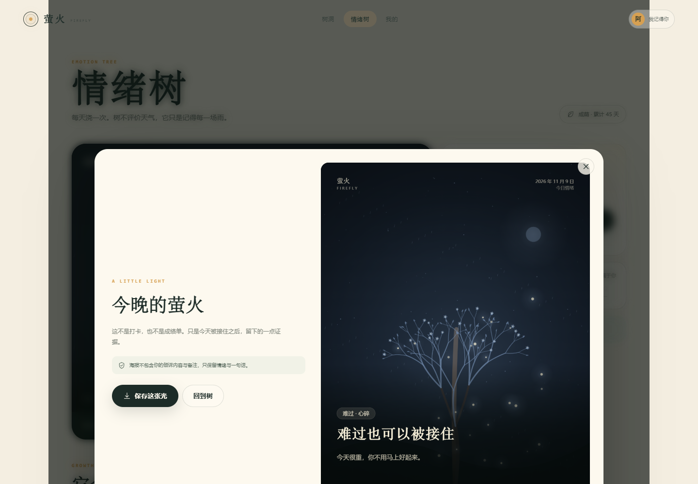

# 萤火 / Firefly

一个先接住情绪、再陪你慢慢往前走的心理陪伴网站原型。

**在线访问：** https://zhuyouyi3rd.github.io/yinghuo/

> 让情绪有处可去，让陪伴有光。

## 运行

需要 Node.js 20+ 与 pnpm。

```bash
pnpm install
pnpm dev
```

打开 `http://127.0.0.1:4310`。

生产构建：

```bash
pnpm build
pnpm preview
```

## 已实现的功能

### 01 树洞

- 文字倾诉、语音输入（Web Speech API，Chrome / Edge 支持最好）
- 三种回应方式：只听 / 轻回应 / 陪我聊一会
- 逐字流式呈现回应，不做“正在输入”的假人类延迟
- 私密历史记录、本地草稿式体验
- 危机关键词识别：高风险时优先展示 12356 / 120 / 110，不继续普通安慰

### 02 知心

- 可跳过的三步画像：称呼 / 人生阶段 / 兴趣 / 近况 / 安慰偏好 / 语气 / 雷区 / 边界
- 未完成核心三项时使用通用关切模式
- 完成“称呼 + 兴趣 + 安慰偏好”后解锁个性化回应
- 本地规则引擎按“接住—具体—正常化—陪伴”组织回应，不主动给机械建议
- 支持编辑、重填、查看“我记得的你”

### 03 情绪树

- 9 个情绪族 × 5 个细分词，共 45 个情绪词
- 每日一次浇灌；断签不枯萎、不惩罚
- 自绘 Canvas 生长引擎：种子 → 初芽 → 抽枝 → 含苞 → 初花 → 成荫 → 萤火
- 每类情绪有不同天空、光色、叶片与粒子效果（雨、雾、火星、夜色、单只萤火等）
- 根据浇灌情绪生成 1080×1440 海报，正向肯定、负向安慰，不建议
- 海报可保存到本地

### 我的

- 画像摘要、倾诉与浇灌统计
- 数据只存在当前浏览器 `localStorage`
- 导出 JSON、清空全部、危机资源入口

## 目录

```text
src/
  components/      导航、弹窗、画像、海报、Canvas 树
  data/            情绪词表
  lib/             本地存储、安慰引擎、Canvas 渲染、海报生成
  pages/           首页 / 树洞 / 情绪树 / 我的
  App.tsx          hash 路由、全局状态、首次使用提示
  styles.css       设计系统与响应式布局
public/
  favicon.svg
screenshots/       桌面与移动端截图
```

## 重要说明

- **这是一个纯前端原型**：没有服务器、账号系统或数据库。数据存在浏览器 `localStorage`，换设备/清缓存会消失。
- **“知心”不是接入了真实大模型**：目前是 `src/lib/comfort.ts` 里的本地规则引擎，用于验证语气、结构和交互。接入 LLM 时保留同样的输入输出与安全校验即可。
- **语音输入**依赖浏览器的 Web Speech API；不支持的浏览器会提示改用文字。
- **危机识别是关键词规则**，不能替代专业判断。上线前需要更完整的风险评估、人工抽检与地区热线配置。
- **上线前必须补齐**：服务端加密存储、删除审计、未成年人策略、专业心理顾问审核、隐私政策与合规评估。
- 萤火是 AI 陪伴，不是心理咨询师、精神科医生或急救服务。

## 设计

- 暖纸色 + 深墨绿 + 萤火金
- 标题使用宋体，正文使用系统无衬线字体
- 首页夜色 Hero + Canvas 萤火粒子
- 动效遵循 `prefers-reduced-motion`

## 截图








